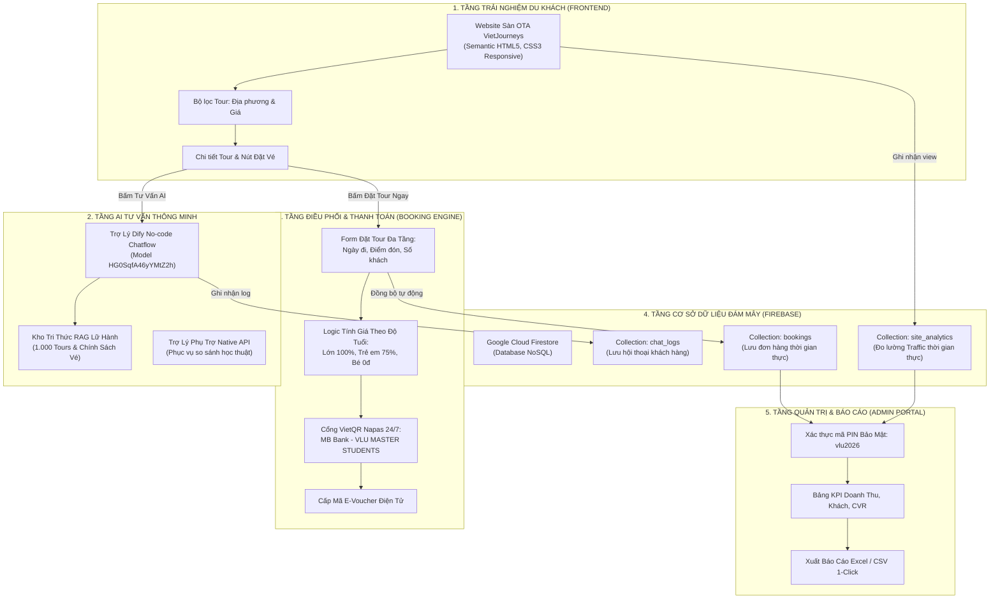

# GIÁO TRÌNH & CẨM NANG THỰC HÀNH TOÀN DIỆN (A - Z)
## TÍCH HỢP AI CHATBOT, ĐÁM MÂY DỮ LIỆU & THANH TOÁN SỐ TRONG KINH DOANH LỮ HÀNH (OTA)
**Chương trình Đào tạo Thạc sĩ Du lịch (VLU Masters in Tourism) — Trường Đại học Văn Lang**  
*Tác giả & Giảng viên hướng dẫn: TS. Lương Thế Bảo*  
*Website dự án mẫu:* [https://otasvietnam.vercel.app](https://otasvietnam.vercel.app)  
*Kho mã nguồn GitHub:* [https://github.com/thebaoluong/OTAs-Vietnam.git](https://github.com/thebaoluong/OTAs-Vietnam.git)

---

## 🎯 PHẦN I: MỤC TIÊU SƯ PHẠM & NGUYÊN TẮC THIẾT KẾ DỰ ÁN

### 1. Mục tiêu đào tạo dành cho Học viên Cao học Du lịch
Khác với sinh viên ngành Công nghệ thông tin thuần túy, học viên cao học du lịch cần tiếp cận chuyển đổi số ở **góc độ quản trị lữ hành, tối ưu chi phí vận hành và nâng cao trải nghiệm du khách (Customer Experience - CX)**:
1. **Năng lực triển khai No-code/Low-code:** Tự tay cấu hình và làm chủ hệ thống AI Chatbot thông minh phục vụ 24/7 mà không cần viết mã nguồn phức tạp.
2. **Kỹ năng ứng dụng RAG (Retrieval-Augmented Generation):** Hiểu rõ cơ chế nạp dữ liệu lịch trình, giá vé và chính sách tour của 150+ Travel Operators vào AI để triệt tiêu hiện tượng "ảo giác" (hallucination).
3. **Tự động hóa luồng chuyển đổi (Booking Funnel):** Tích hợp quy trình đặt tour chuẩn hóa, tính toán giá vé theo độ tuổi, tạo mã VietQR thanh toán 24/7 và cấp E-voucher tức thì.
4. **Phân tích dữ liệu & Ra quyết định:** Vận hành Dashboard báo cáo doanh thu, đo lường tỷ lệ chuyển đổi (CVR), theo dõi lượt truy cập thời gian thực và trích xuất dữ liệu ra Excel phục vụ đề tài nghiên cứu/luận văn.
5. **Tư duy tối ưu ngân sách ($0 Budget):** Vận hành toàn bộ hệ thống bằng các dịch vụ Free-tier đám mây chuẩn quốc tế (GitHub, Vercel, Firebase Cloud, Dify.ai, VietQR API).

---

## 🏛️ PHẦN II: KIẾN TRÚC HỆ THỐNG 5 TẦNG (SYSTEM ARCHITECTURE)



---

## 🛠️ PHẦN III: HƯỚNG DẪN THỰC HÀNH 7 BƯỚC TỪ A ĐẾN Z

```
Thư mục dự án:
13_Tich hop chatbot tu dong/
├── index.html                   # Giao diện sàn OTA, modal đặt tour & admin dialog
├── css/
│   └── styles.css               # Hệ thống design tokens, bố cục flexbox & responsive
├── js/
│   ├── app.js                   # Logic lọc tour, VietQR, Dify dispatch & Admin analytics
│   └── firebase-service.js      # Kết nối Google Firebase Firestore SDK
├── data/
│   ├── 1000_tours_vietnam.json  # Database 1.000 tour chuẩn hóa 3 miền từ 150+ operators
│   ├── DU_LIEU_DU_LICH_VIETNAM.txt # Tri thức RAG nạp vào Dify Chatflow
│   └── Danh_Sach_Dat_Tour_OTAs_Vietnam.xlsx # Mẫu xuất báo cáo Excel
```

### BƯỚC 1: XÂY DỰNG GIAO DIỆN SÀN OTA THƯƠNG MẠI
1. Cấu trúc semantic HTML5 chuẩn quốc tế:
   - Header hiển thị Logo VietJourneys, hotline 1900 6868, nút mở nhanh trợ lý AI và nút vào Admin Portal.
   - Banner Hero đón khách kèm thanh tìm kiếm tức thì theo từ khóa.
   - Khu vực lọc đa tiêu chí: Theo vùng miền (Bắc - Trung - Nam - Tây Nguyên) và theo tầm giá (Dưới 1 triệu, 1-3 triệu, trên 3 triệu).
   - Lưới hiển thị Card Tour tự động render từ file JSON với hiệu ứng hover và huy hiệu đánh giá sao.
2. Thiết kế tông màu chủ đạo:
   - Xanh ngọc lục bảo (Emerald Green `#0a5c36`) tượng trưng cho thiên nhiên và sự tin cậy.
   - Vàng ánh kim (`#d97706`) tượng trưng cho mức giá ưu đãi và sự sang trọng.

---

### BƯỚC 2: TÍCH HỢP BOOKING ENGINE & VIETQR THANH TOÁN 24/7
Học viên thiết lập quy trình đặt tour khép kín để du khách hoàn tất giữ chỗ chỉ trong 60 giây:

#### 1. Logic tính giá vé theo độ tuổi tiêu chuẩn ngành du lịch:
$$\text{Tổng tiền} = (N_{\text{người lớn}} \times P) + (N_{\text{trẻ em}} \times 0.75 \times P) + (N_{\text{em bé}} \times 0)$$
- **Người lớn (Từ 10 tuổi):** $100\%$ giá niêm yết.
- **Trẻ em (5 – dưới 10 tuổi):** $75\%$ giá niêm yết (có ghế riêng, suất ăn riêng, ngủ cùng phụ huynh).
- **Em bé (Dưới 5 tuổi):** $0\text{ đ}$ (miễn phí hoàn toàn).

#### 2. Cổng sinh mã VietQR Napas chuẩn quốc gia:
Sử dụng chuẩn API mở của VietQR với ngân hàng Quân Đội (MB Bank):
```javascript
// Cấu trúc URL sinh mã VietQR tự động
const bankId = 'MB';
const accountNo = '0988888888';
const accountName = 'VLU MASTER STUDENTS';
const template = 'compact2';
const amount = totalAmount;
const description = `BOOKING ${bookingCode}`;

const qrUrl = `https://img.vietqr.io/image/${bankId}-${accountNo}-${template}.png?amount=${amount}&addInfo=${encodeURIComponent(description)}&accountName=${encodeURIComponent(accountName)}`;
```

#### 3. Cấp mã vé điện tử E-Voucher tức thì:
Khi khách bấm xác nhận chuyển khoản:
- Hệ thống phát sinh mã booking ngẫu nhiên dạng `VLU-XXXXXX`.
- Hiển thị vé điện tử (E-voucher) trực quan kèm mã QR xác thực và thông tin nhà điều hành địa phương.

---

### BƯỚC 3: CẤU HÌNH TRỢ LÝ NO-CODE TRÊN DIFY.AI

Dify.ai đóng vai trò là "Bộ não tư vấn tự động" của website lữ hành:

#### 1. Nạp tri thức RAG (Knowledge Base):
1. Đăng nhập [https://cloud.dify.ai/](https://cloud.dify.ai/) ──► Vào **Knowledge** ──► Bấm **Create Knowledge**.
2. Tải lên tệp `data/DU_LIEU_DU_LICH_VIETNAM.txt` (chứa đầy đủ lịch trình 1.000 tour, chính sách trẻ em, hoàn hủy bão lũ).
3. Chọn cơ chế phân đoạn: **Economy (Kinh tế)** để được miễn phí hoàn toàn $0 credit.
4. Bấm **Save & Process**.

#### 2. Xây dựng Chatflow trực quan trên Canvas:
- **Node `Start`:** Thu thập câu hỏi của khách hàng (`sys.query`).
- **Node `Knowledge Retrieval`:** Truy xuất các đoạn văn bản tương thích nhất từ kho dữ liệu tour.
- **Node `LLM`:** Sử dụng mô hình `gemini-2.5-flash` hoặc `gpt-4o-mini`, kết hợp bối cảnh (`context`) từ kho tri thức và hệ thống chỉ dẫn (System Instructions).
- **Node `Answer`:** Xuất câu trả lời định dạng Markdown thân thiện.
- Bấm **Publish** ──► Lấy mã định danh Chatbot ID: `HG0SqfA46yYMtZ2h`.

#### 3. Nhúng giao diện nguyên bản vào Website:
```html
<aside class="dify-window" id="difyWindow" hidden>
  <!-- Nút đóng tròn nổi thanh lịch góc trên phải -->
  <button type="button" class="dify-floating-close-btn" id="closeDifyBtn">✕</button>
  <iframe
    src="https://udify.app/chatbot/HG0SqfA46yYMtZ2h"
    style="width: 100%; height: 100%; border: none;"
    allow="microphone;clipboard-write">
  </iframe>
</aside>
```
> [!IMPORTANT]
> **Điểm mấu chốt:** Khung `<iframe>` Dify đã có sẵn thanh tiêu đề (`OTAs-VLU master`) và ô nhập tin nhắn. Không bọc thêm tiêu đề HTML bên ngoài để tránh hiện tượng lặp 2 tiêu đề hoặc che mất ô chat.

---

### BƯỚC 4: KẾT NỐI ĐÁM MÂY DỮ LIỆU GOOGLE FIREBASE

1. Truy cập [Firebase Console](https://console.firebase.google.com/), tạo dự án `website-otas-vietnam`.
2. Tạo cơ sở dữ liệu **Firestore Database** ở chế độ `Test mode`:
   - `bookings`: Lưu trữ mọi đơn đặt tour gồm: Họ tên, SĐT, Email, Tên tour, Ngày đi, Điểm đón, Số khách (Lớn/Nhỏ/Bé), Tổng tiền, Trạng thái thanh toán, Thời gian tạo.
   - `chat_logs`: Lưu trữ câu hỏi của khách và phản hồi của trợ lý AI.
   - `site_analytics`: Lưu lượt truy cập thực tế (Realtime Traffic) để tính tỷ lệ chuyển đổi.
3. Nhúng Firebase SDK vào file `js/firebase-service.js`:
```javascript
const firebaseConfig = {
  apiKey: "AIzaSy...",
  projectId: "website-otas-vietnam",
  appId: "1:..."
};
firebase.initializeApp(firebaseConfig);
const db = firebase.firestore();
```

---

### BƯỚC 5: XÂY DỰNG ADMIN DASHBOARD & XUẤT BÁO CÁO EXCEL

Để giảng viên và học viên cao học có số liệu phân tích:

1. **Bảo mật truy cập bằng mã PIN:**
   - Khi bấm vào nút **"🔐 Quản Trị Hệ Thống"**, hộp thoại yêu cầu nhập PIN bảo vệ (`vlu2026`).
2. **Bảng tổng hợp chỉ số KPI kinh doanh:**
   - **Tổng doanh thu:** Cộng dồn giá trị tất cả các booking hợp lệ.
   - **Số lượt đặt tour:** Tổng số đơn hàng trong cơ sở dữ liệu.
   - **Lượng khách phục vụ:** Tổng số hành khách (người lớn + trẻ em).
   - **Giá trị đơn trung bình (AOV):** $\text{AOV} = \frac{\text{Tổng doanh thu}}{\text{Số booking}}$.
   - **Lượt truy cập (Traffic):** Đọc thời gian thực từ Firestore.
   - **Tỷ lệ chuyển đổi (CVR):** $\text{CVR} = \frac{\text{Số booking}}{\text{Lượt truy cập}} \times 100\%$.
3. **Chức năng xuất dữ liệu Excel / CSV 1-Click:**
   - Tự động chuyển đổi bảng dữ liệu sang tệp `.csv` với chuẩn mã hóa tiếng Việt UTF-8 BOM (`\uFEFF`) để mở trên Microsoft Excel không bị lỗi font chữ.

---

### BƯỚC 6: TỐI ƯU GIAO DIỆN CHATBOT CHUẨN THƯƠNG MẠI
- **Loại bỏ toàn bộ nhãn kỹ thuật:** Xóa các chữ "Gemini 3.8", "Dify Chatflow", "No-code RAG", "Firestore" khỏi tầm mắt du khách. Chatbot xưng hô lịch thiệp: *"Xin chào quý khách! Tôi là Trợ lý Du lịch VietJourneys 🇻🇳..."*.
- **Điều hướng thông minh:** Bất kỳ thao tác nào liên quan đến **"💬 Tư Vấn Qua AI"** (trong popup xem chi tiết tour, thanh menu trên cùng, chân trang footer) đều tự động chuyển hướng mượt mà sang **Trợ lý Dify Chatflow**.
- **Sửa lỗi thanh cuộn trên điện thoại di động:** Thiết lập thuộc tính `flex: 1 1 0%; min-height: 0; overflow-y: auto; -webkit-overflow-scrolling: touch;` và ghim ô nhập liệu ở đáy màn hình bằng `position: fixed` trên màn hình dưới 768px.

---

### BƯỚC 7: QUẢN LÝ MÃ NGUỒN GITHUB & TRIỂN KHAI VERCEL

1. Khởi tạo Git và đẩy lên GitHub:
```bash
git init
git add .
git commit -m "Phat hanh phien ban OTAs Vietnam tich hop AI Chatbot va VietQR"
git branch -M main
git remote add origin https://github.com/thebaoluong/OTAs-Vietnam.git
git push -u origin main
```
2. Triển khai lên Vercel:
   - Kết nối Vercel với kho GitHub `thebaoluong/OTAs-Vietnam`.
   - Chọn Framework: `Other`.
   - Bấm **Deploy**. Sau 30 giây website chính thức phát hành toàn cầu tại:  
     👉 **`https://otasvietnam.vercel.app`** (bảo mật HTTPS ổ khóa xanh, tốc độ CDN toàn cầu).

---

## 📚 PHẦN IV: BỘ CÂU LỆNH PROMPT CHUẨN MỰC CHO HỌC VIÊN

### Prompt 1: System Instruction cho AI Tư Vấn Lữ Hành
```text
Bạn là Trợ lý tư vấn du lịch trực tuyến của sàn lữ hành VietJourneys.

NHIỆM VỤ CHÍNH:
1. Lắng nghe nhu cầu, điểm đến mong muốn, ngân sách và thời gian của khách hàng để gợi ý tour phù hợp từ kho tri thức.
2. Với mỗi tour gợi ý, bắt buộc nêu rõ: Tên tour, Giá niêm yết (VNĐ), Thời lượng và Nhà điều hành phụ trách.
3. Giải thích chính xác chính sách trẻ em: Dưới 5 tuổi miễn phí; 5 đến dưới 10 tuổi tính 75%; từ 10 tuổi trở lên tính 100%.
4. Quy định hoàn hủy tour: Trước 20 ngày phí 10%; 10-19 ngày phí 30%; 5-9 ngày phí 50%; 2-4 ngày phí 70%; trong 24h phí 100%.

PHONG CÁCH GIAO TIẾP:
- Niềm nở, thân thiện, xưng "em/tôi" và gọi khách là "quý khách".
- Tuyệt đối không đề cập đến các thuật ngữ kỹ thuật (AI model, API, Firestore, RAG...). Trả lời tự nhiên như tư vấn viên du lịch chuyên nghiệp.
```

### Prompt 2: Kịch bản Chốt Sale & Hướng dẫn Đặt Tour
```text
Khi khách hàng bày tỏ ý định muốn đặt tour hoặc hỏi về giá vé:
1. Chúc mừng khách đã chọn được hành trình ưng ý.
2. Hướng dẫn khách: "Quý khách có thể bấm trực tiếp vào nút 'Đặt Tour Ngay' trên màn hình để chọn ngày đi, điểm đón và quét mã VietQR chuyển khoản nhanh 24/7."
3. Nhắc nhở khách chuẩn bị thông tin hành khách để nhà điều hành làm thủ tục bảo hiểm du lịch (mức bồi thường 100 triệu VNĐ).
```

---

## 🎓 PHẦN V: GỢI Ý 3 HƯỚNG ĐỀ TÀI LUẬN VĂN THẠC SĨ TỪ DỰ ÁN

| Hướng đề tài | Tên đề tài gợi ý | Phương pháp nghiên cứu khả thi |
| :--- | :--- | :--- |
| **Hướng 1: Chuyển đổi số & Tỷ lệ chốt đơn (Conversion Rate)** | *Nghiên cứu tác động của Trợ lý AI Chatbot và Cổng thanh toán VietQR tức thì đến hành vi ra quyết định đặt tour của du khách trên sàn thương mại điện tử du lịch.* | Thực nghiệm A/B Testing trên website: Nhóm có Chatbot hỗ trợ vs. Nhóm chỉ xem thông tin tĩnh; trích xuất dữ liệu từ Firebase để phân tích định lượng. |
| **Hướng 2: Quản trị Lữ hành No-code cho SMEs** | *Mô hình ứng dụng trí tuệ nhân tạo No-code và công nghệ RAG trong tối ưu hóa chi phí vận hành cho các doanh nghiệp lữ hành vừa và nhỏ tại Việt Nam.* | Phân tích bài toán chi phí $0 so với phần mềm đóng gói; đo lường thời gian phản hồi khách hàng và mức độ chính xác của thông tin tour. |
| **Hướng 3: Trải nghiệm khách hàng (Customer Experience - CX)** | *Đánh giá sự hài lòng của du khách đối với quy trình tư vấn tự động và phát hành E-voucher trực tuyến: Nghiên cứu thực nghiệm tại TP. Hồ Chí Minh.* | Khảo sát người dùng thực tế sau khi đặt tour trên sàn VietJourneys; phân tích cấu trúc tuyến tính SEM/PLS để kiểm định các giả thuyết. |

---

## ✅ PHẦN VI: CHECKLIST ĐÁNH GIÁ KẾT QUẢ HỌC TẬP CỦA HỌC VIÊN

- [ ] **Tiêu chí 1:** Website vận hành ổn định trên Vercel, giao diện tương thích tốt trên điện thoại di động.
- [ ] **Tiêu chí 2:** Chatbot Dify trả lời chính xác thông tin tour theo dữ liệu được nạp trong file tri thức.
- [ ] **Tiêu chí 3:** Tính toán giá vé chính xác theo 3 nhóm tuổi (Người lớn $100\%$, Trẻ em $75\%$, Bé $0\%$).
- [ ] **Tiêu chí 4:** Sinh mã VietQR chuyển khoản với đúng chủ tài khoản `VLU MASTER STUDENTS`.
- [ ] **Tiêu chí 5:** Đơn hàng và lượt truy cập được ghi nhận tự động vào Google Firebase Firestore.
- [ ] **Tiêu chí 6:** Đăng nhập Admin Portal bằng mã PIN `vlu2026`, xem được báo cáo KPI và xuất file Excel thành công.
- [ ] **Tiêu chí 7:** Chi phí vận hành toàn bộ giải pháp đạt chuẩn tối ưu $0.
