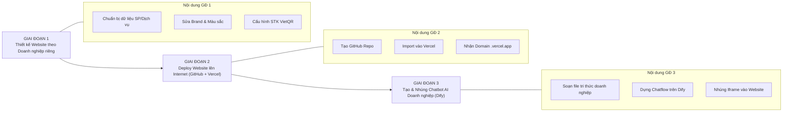

# HƯỚNG DẪN DỰ ÁN MÔN HỌC (ASSIGNMENT BRIEF & WORKBOOK)
## XÂY DỰNG WEBSITE DOANH NGHIỆP DU LỊCH, TRIỂN KHAI TOÀN CẦU & TÍCH HỢP AI CHATBOT THƯƠNG MẠI
**Chương trình Đào tạo Thạc sĩ Du lịch (VLU Masters in Tourism) — Trường Đại học Văn Lang**  
*Giảng viên phụ trách: TS. Lương Thế Bảo*

---

## 📌 1. ĐỀ BÀI VÀ YÊU CẦU DỰ ÁN (PROJECT OVERVIEW)

### Mục tiêu dự án
Mỗi học viên (hoặc nhóm học viên) sẽ **chọn chính cơ sở kinh doanh thực tế của mình** (hoặc một mô hình kinh doanh du lịch mục tiêu mà học viên đang ấp ủ/nghiên cứu) để hoàn thiện một giải pháp chuyển đổi số toàn diện gồm 3 trụ cột:
1. **Website thương mại:** Giới thiệu sản phẩm/dịch vụ, có chức năng đặt chỗ trực tuyến và thanh toán VietQR Napas 24/7.
2. **Triển khai (Deploy) toàn cầu:** Đưa website lên Internet với tên miền thực tế thông qua GitHub và Vercel (bảo mật HTTPS, tốc độ cao, chi phí $0).
3. **Chatbot AI thông minh:** Tích hợp một Trợ lý ảo (Dify AI) được huấn luyện từ chính bảng giá, chính sách và lịch trình dịch vụ của doanh nghiệp để tự động hóa tư vấn và chốt sale 24/7.

### Các loại hình cơ sở kinh doanh học viên có thể lựa chọn:
* 🏨 **Lưu trú (Accommodation):** Khách sạn, Resort, Homestay, Farmstay, Glamping, Villa nguyên căn.
* 🚗 **Vận chuyển du lịch (Transportation):** Cho thuê xe tự lái/limousine, du thuyền, cano cao tốc, xe buýt du lịch.
* ✈️ **Đại lý lữ hành / Tour:** Công ty du lịch inbound/outbound, tour trải nghiệm địa phương, trekking, tour ẩm thực.
* 🍽️ **Ẩm thực & Dịch vụ giải trí (F&B & Leisure):** Nhà hàng đặc sản, quán cà phê ngắm cảnh/check-in, tour nông nghiệp trải nghiệm.
* 🎟️ **Khu điểm du lịch (Attractions):** Khu bảo tồn, làng nghề truyền thống, điểm tham quan sinh thái.

---

## 🧭 2. LỘ TRÌNH 3 GIAI ĐOẠN HOÀN THÀNH DỰ ÁN



---

## 🛠️ 3. HƯỚNG DẪN CHI TIẾT TỪNG BƯỚC THỰC HIỆN

### GIAI ĐOẠN 1: TÙY BIẾN WEBSITE THEO CƠ SỞ KINH DOANH CỦA MÌNH

Học viên sử dụng bộ mã nguồn mẫu đã được chuẩn hóa và thực hiện các bước tùy biến sau:

#### Bước 1.1: Chuẩn bị tệp dữ liệu sản phẩm/dịch vụ của doanh nghiệp
Trong thư mục `data/`, mở tệp dữ liệu (hoặc tạo file mới `data/my_business_products.json`) để điền thông tin thực tế:
* **Nếu là Khách sạn/Homestay:** Tên phòng (Deluxe, Suite, Dorm), số khách tối đa, tiện ích (hồ bơi, bữa sáng, ban công), giá theo đêm, hình ảnh phòng.
* **Nếu là Tour lữ hành:** Tên tour, thời lượng, điểm xuất phát, phương tiện, giá tour người lớn & trẻ em, lịch trình chi tiết.
* **Nếu là Thuê xe/Du thuyền:** Loại phương tiện, số ghế, khu vực đón trả, giá theo giờ/ngày.

#### Bước 1.2: Cá nhân hóa thương hiệu trong `index.html`
1. Thay đổi tên thương hiệu và Slogan tại thẻ `<title>` và thanh Navigation Header:
   ```html
   <!-- Ví dụ với Homestay -->
   <a href="#" class="brand-logo">
     <span class="logo-icon">🏡</span>
     <div class="logo-text">
       <span class="brand-name">Mộc Châu Eco Homestay</span>
       <span class="brand-sub">Trải nghiệm xanh giữa lòng cao nguyên</span>
     </div>
   </a>
   ```
2. Cập nhật số Hotline thực tế của cơ sở kinh doanh:
   ```html
   <a href="tel:0909123456" class="hotline-link">📞 Hotline: 0909 123 456</a>
   ```

#### Bước 1.3: Cài đặt tài khoản nhận tiền chuyển khoản VietQR Napas 24/7
Trong file `js/app.js`, tìm đến hàm sinh mã VietQR và thay thế bằng thông tin tài khoản ngân hàng thực tế của doanh nghiệp học viên:
```javascript
// THAY BẰNG THÔNG TIN TÀI KHOẢN NGÂN HÀNG CỦA DOANH NGHIỆP BẠN
const BANK_CONFIG = {
  bankId: 'MB',                 // Mã ngân hàng (MB, VCB, TCB, ACB, TPB, VPB, ICB...)
  accountNo: '0988888888',       // Số tài khoản người nhận
  accountName: 'TEN DOANH NGHIEP CUA BAN', // Tên chủ tài khoản (viết hoa không dấu)
  template: 'compact2'           // Giao diện mẫu QR
};
```
> [!NOTE]
> Khi khách hàng bấm đặt dịch vụ, mã QR sẽ tự động điền sẵn chính xác **Số tiền cần thanh toán** và **Mã đơn hàng** để khách quét chuyển tiền ngay trên App ngân hàng mà không cần gõ thủ công.

---

### GIAI ĐOẠN 2: TRIỂN KHAI (DEPLOY) WEBSITE LÊN INTERNET TOÀN CẦU

Học viên đưa sản phẩm từ máy tính cá nhân lên mạng Internet để khách hàng ở bất kỳ đâu trên thế giới cũng có thể truy cập được:

#### Bước 2.1: Đưa mã nguồn lên GitHub cá nhân
1. Đăng ký tài khoản miễn phí tại [https://github.com/](https://github.com/).
2. Bấm nút **New repository** ──► Đặt tên dự án (Ví dụ: `homestay-mocchau` hoặc `saigon-foodtour`).
3. Mở cửa sổ Terminal (hoặc Git Bash) tại thư mục dự án và chạy các lệnh:
   ```bash
   git init
   git add .
   git commit -m "Khoi tao website doanh nghiep cua toi"
   git branch -M main
   git remote add origin https://github.com/<tai-khoan-github-cua-ban>/<ten-du-an>.git
   git push -u origin main
   ```

#### Bước 2.2: Xuất bản tự động trên Vercel ($0 chi phí)
1. Truy cập [https://vercel.com/](https://vercel.com/) ──► Đăng nhập bằng tài khoản **GitHub**.
2. Bấm **Add New...** ──► Chọn **Project**.
3. Chọn kho mã nguồn bạn vừa đẩy lên ──► Bấm **Import**.
4. Giữ nguyên cài đặt mặc định (Framework Preset: `Other`) ──► Bấm nút **Deploy**.
5. Sau 20 giây, Vercel cấp tên miền chính thức có ổ khóa xanh bảo mật HTTPS:
   👉 **`https://ten-doanh-nghiep.vercel.app`**

> [!TIP]
> **Điểm ưu việt:** Bất kỳ khi nào học viên cập nhật thêm phòng mới, đổi giá dịch vụ hoặc tinh chỉnh giao diện trên máy tính, chỉ cần gõ `git push`, website trên Vercel sẽ tự động cập nhật trong vòng 30 giây!

---

### GIAI ĐOẠN 3: HUẤN LUYỆN & TÍCH HỢP AI CHATBOT VÀO WEBSITE

Đây là điểm nhấn công nghệ giúp cơ sở kinh doanh của học viên có một **"Chuyên viên chăm sóc khách hàng 24/7"**:

#### Bước 3.1: Soạn tệp tri thức doanh nghiệp (`data/KNOWLEDGE_BASE.txt`)
Học viên tổng hợp thông tin kinh doanh của cơ sở mình thành một văn bản rõ ràng:
1. **Thông tin chung:** Địa chỉ, chỉ đường, số điện thoại lễ tân/chủ nhà, giờ nhận/trả phòng (Check-in/Check-out).
2. **Bảng giá & Chi tiết dịch vụ:** Từng loại phòng/tour, giá ngày thường, giá cuối tuần/ngày lễ, các dịch vụ đã bao gồm.
3. **Chính sách phụ thu:** Trẻ em, người thêm, thú cưng, dịch vụ BBQ, cho thuê xe máy.
4. **Quy định hoàn hủy & đặt cọc:** Số phần trăm cọc giữ chỗ, quy định dời ngày do thời tiết xấu.
5. **Các điểm tham quan & trải nghiệm lân cận:** Quán ăn ngon gần đó, cung đường trekking, đặc sản nên mua làm quà.

#### Bước 3.2: Khởi tạo Trợ lý AI trên Dify Cloud
1. Truy cập [https://cloud.dify.ai/](https://cloud.dify.ai/) (miễn phí).
2. Vào mục **Knowledge** ──► Bấm **Create Knowledge** ──► Tải lên file `KNOWLEDGE_BASE.txt` vừa soạn.
   - Chọn phân đoạn: **Economy (Kinh tế)** để được miễn phí hoàn toàn.
   - Bấm **Save & Process**.
3. Vào mục **Studio** ──► Bấm **Create from Blank** ──► Chọn **Chatflow**.
4. Thiết lập khối **LLM (Large Language Model)**:
   - **Model:** Chọn `gemini-2.5-flash` hoặc `gpt-4o-mini`.
   - **Context:** Chọn biến kết quả từ khối *Knowledge Retrieval*.
   - **Instructions (Prompt):** Dán câu lệnh điều khiển nhân cách AI:

```text
Bạn là "Chuyên viên tư vấn & Chăm sóc khách hàng" của [TÊN CƠ SỞ KINH DOANH CỦA BẠN].

NHIỆM VỤ:
1. Chào đón khách hàng niềm nở, giới thiệu các loại phòng/dịch vụ/tour phù hợp với nhu cầu và ngân sách của khách.
2. Cung cấp báo giá chính xác, thông tin tiện ích và chính sách phụ thu theo đúng tệp dữ liệu tri thức của cơ sở.
3. Khi khách có ý định đặt chỗ: Hướng dẫn khách bấm nút "Đặt Chỗ / Đặt Tour" trên website để chọn ngày và quét mã VietQR thanh toán nhanh 24/7.
4. Nếu khách hỏi địa chỉ hoặc đường đi: Cung cấp địa chỉ chi tiết và hướng dẫn di chuyển thuận tiện nhất.

PHONG CÁCH:
- Giọng điệu thân thiện, lịch sự, mến khách (xưng "em/tôi" và gọi khách là "quý khách" hoặc "anh/chị").
- Trả lời súc tích, rõ ràng, gạch đầu dòng các ý chính.
- Tuyệt đối không nhắc các từ ngữ kỹ thuật (AI model, RAG, prompt, database...).
```

5. Bấm **Publish** (Xuất bản) ──► Vào **Overview** ──► Copy đường link web app dạng:
   `https://udify.app/chatbot/<CHATBOT_ID>`

#### Bước 3.3: Nhúng Chatbot vào Website của bạn
Mở file `index.html` của bạn, thay đường link iframe của bạn vào:
```html
<aside class="dify-window" id="difyWindow" hidden>
  <button type="button" class="dify-floating-close-btn" id="closeDifyBtn" aria-label="Đóng chat">✕</button>
  <iframe
    src="https://udify.app/chatbot/<CHATBOT_ID_CUA_BAN>"
    style="width: 100%; height: 100%; border: none;"
    allow="microphone;clipboard-write">
  </iframe>
</aside>
```

---

## 📊 4. TIÊU CHÍ NGHIỆM THU & ĐÁNH GIÁ ĐIỂM (RUBRIC DỰ ÁN)

| Tiêu chí | Trọng số | Mô tả yêu cầu đạt chuẩn |
| :--- | :---: | :--- |
| **1. Tính thực tế & Tính thương hiệu** | 25% | Website thể hiện rõ ràng cơ sở kinh doanh đã chọn (Logo, Slogan, địa chỉ, hình ảnh thực tế, bảng giá dịch vụ logic). |
| **2. Booking Engine & VietQR 24/7** | 25% | Tính năng đặt chỗ hoạt động tốt; tính đúng giá theo số lượng khách/đêm; sinh mã VietQR đúng STK và tên chủ tài khoản cơ sở kinh doanh. |
| **3. Trợ lý AI Chatbot Doanh nghiệp** | 25% | Chatbot trả lời thông minh, đúng bảng giá và chính sách của cơ sở kinh doanh; không bị ảo giác; hỗ trợ chốt đơn tự nhiên. |
| **4. Triển khai & Vận hành Internet** | 15% | Website hoạt động mượt mà trên link Vercel; tương thích tốt trên điện thoại di động (Mobile Responsive); cuộn chat trơn tru. |
| **5. Báo cáo & Phân tích Quản trị** | 10% | Đăng nhập Admin xem được số lượng đặt chỗ và xuất báo cáo dữ liệu khách hàng ra file Excel. |
| **TỔNG ĐIỂM** | **100%** | **Đạt chuẩn Nghiệm thu Đề án Chuyển đổi số Lữ hành** |

---

## 💡 5. HỒ SƠ NỘP BÀI DỰ ÁN DÀNH CHO HỌC VIÊN

Khi hoàn thành dự án, mỗi học viên chuẩn bị một file báo cáo tóm tắt (PDF hoặc Word) gồm các nội dung:
1. **Thông tin sinh viên:** Họ tên, Mã học viên, Tên cơ sở kinh doanh đã chọn.
2. **Đường link sản phẩm thực tế:**
   - Link website đang hoạt động (Ví dụ: `https://myhomestay.vercel.app`).
   - Link kho mã nguồn GitHub (Ví dụ: `https://github.com/hocvien/myhomestay`).
   - Link chatbot Dify (Ví dụ: `https://udify.app/chatbot/...`).
3. **Hình ảnh minh chứng:**
   - Ảnh chụp giao diện website trên máy tính và điện thoại.
   - Ảnh chụp cuộc hội thoại tư vấn thử nghiệm với Chatbot AI.
   - Ảnh chụp màn hình mã VietQR được sinh tự động khi đặt dịch vụ.
   - Ảnh chụp màn hình Admin Portal hiển thị danh sách đơn đặt và file Excel đã tải về.
4. **Đánh giá hiệu quả kinh doanh:** Ước tính mức tiết kiệm thời gian trực tổng đài và tiềm năng tăng tỷ lệ chốt đơn tự động của cơ sở kinh doanh nhờ ứng dụng giải pháp này.
